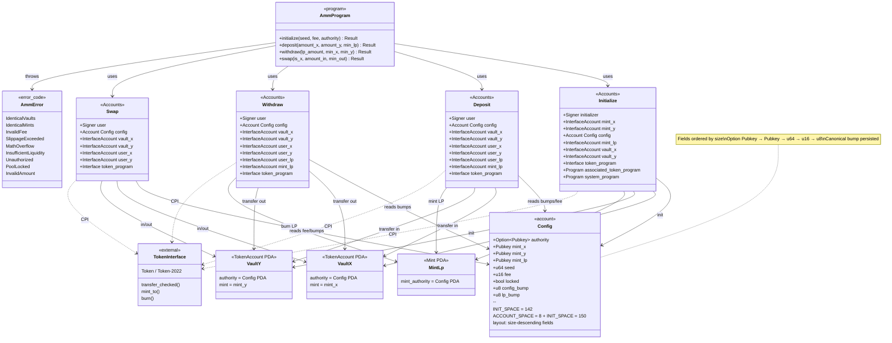

# Class diagram — solana-amm-anchor

> 🇪🇸 [Versión en español](diagrama-clases-ES.md) · [Index](../README.md)

Static model of the AMM program (Anchor). It shows state accounts, instruction contexts, errors, and relationships with the SPL interfaces.

## Design notes

| Element | Rule |
|---------|------|
| `Config` | `#[account]` + 8-byte discriminator; anti type-cosplay |
| Space | Exactly `8 + Config::INIT_SPACE` |
| Vaults | Distinct keys; authority = `Config` PDA |
| LP | First deposit locks minimum liquidity |
| Tokens | Only `token_interface` + `transfer_checked` |
| Math | Constant product; fee on input; `u128` + `checked_*` |
