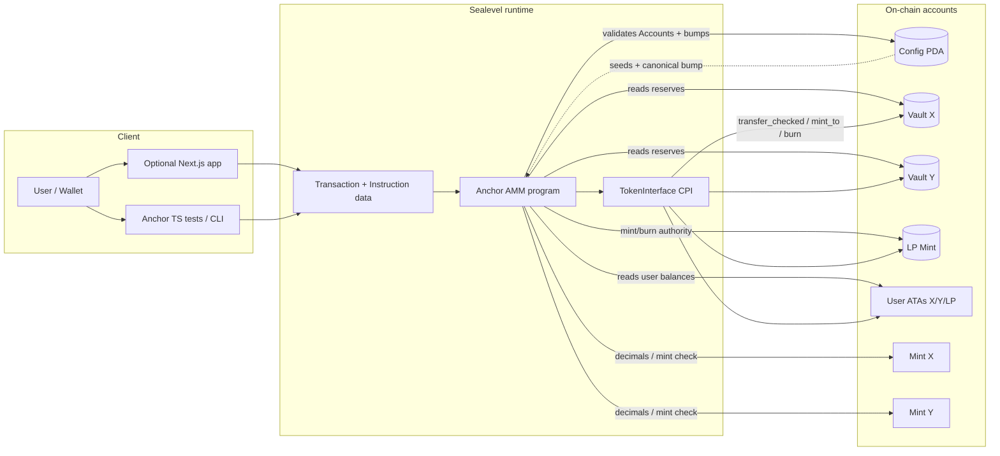
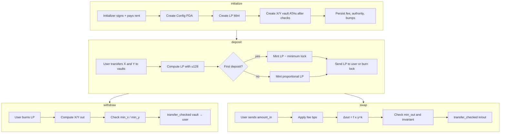

# Flow diagram — solana-amm-anchor

> 🇪🇸 [Versión en español](diagrama-flujo-ES.md) · [Index](../README.md)

Data and component flow between the user, the client, the Solana runtime, and the AMM accounts.

## Per-operation flow (data view)

## Trust boundaries

| Layer | Trusts | Does not trust |
|-------|--------|----------------|
| Client | UX, argument serialization | Security validation |
| Program | Anchor constraints, stored PDA bumps | Accounts without `owner`/discriminator |
| Token program | Validated interfaces | Arbitrary program IDs (anti arbitrary CPI) |
