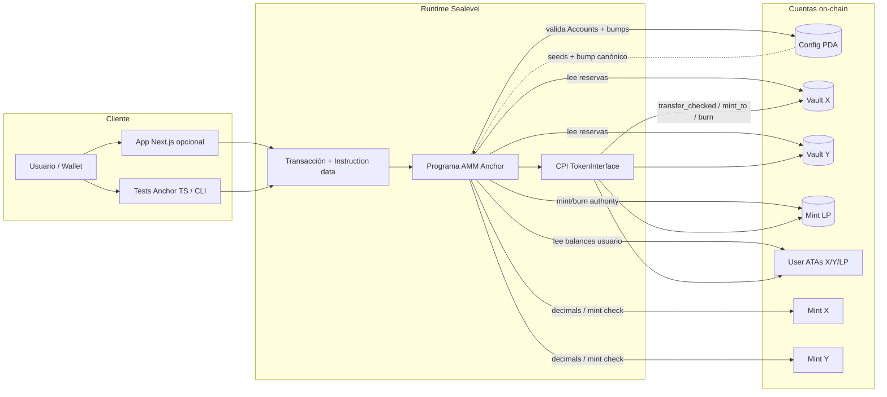
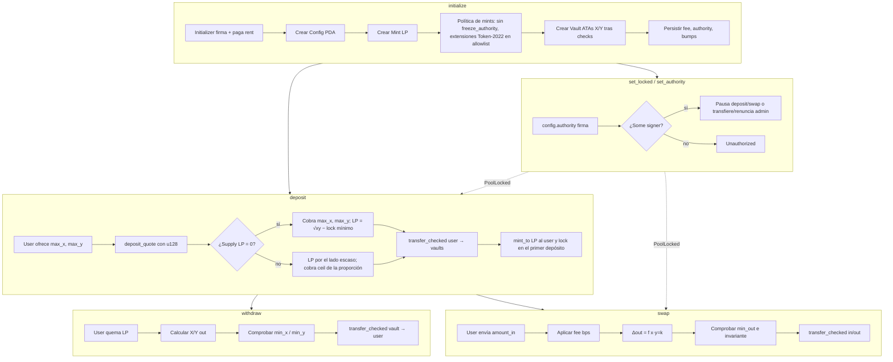

# Diagrama de flujo — solana-amm-anchor

> 🇬🇧 [English version](diagrama-flujo-EN.md) · [Índice](../README.md)

Flujo de datos y componentes entre usuario, cliente, runtime Solana y cuentas del AMM.

## Flujo por operación (vista de datos)

## Límites de confianza

| Capa | Confía en | No confía en |
|------|-----------|--------------|
| Cliente | UX, serialización de args | Validación de seguridad |
| Programa | Constraints Anchor, PDA bumps guardados | Cuentas sin `owner`/discriminator; saldos previos del vault en el primer depósito |
| Mints | SPL Token / Token-2022 sin freeze authority ni extensiones peligrosas | Freeze authority, transfer fee, delegado permanente, hooks |
| Admin | Solo puede pausar deposit/swap o ceder el rol | Nunca puede bloquear retiros ni mover fondos |
| Token program | Interfaces validadas | Program IDs arbitrarios (anti arbitrary CPI) |
