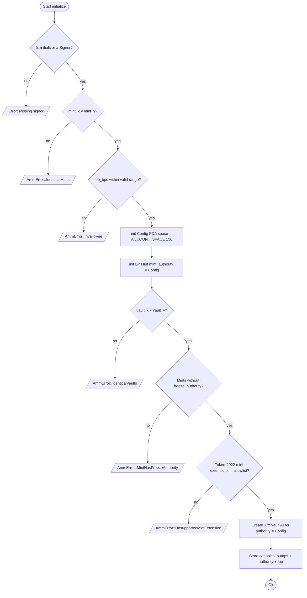
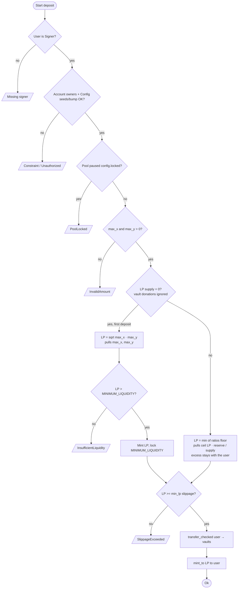
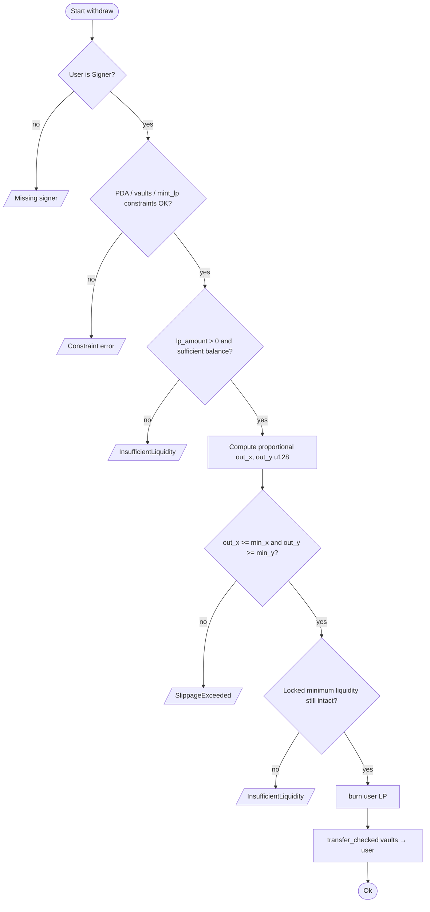
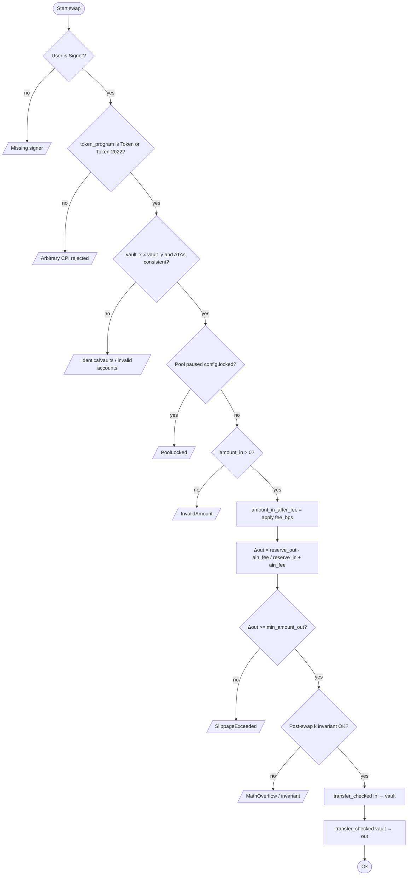
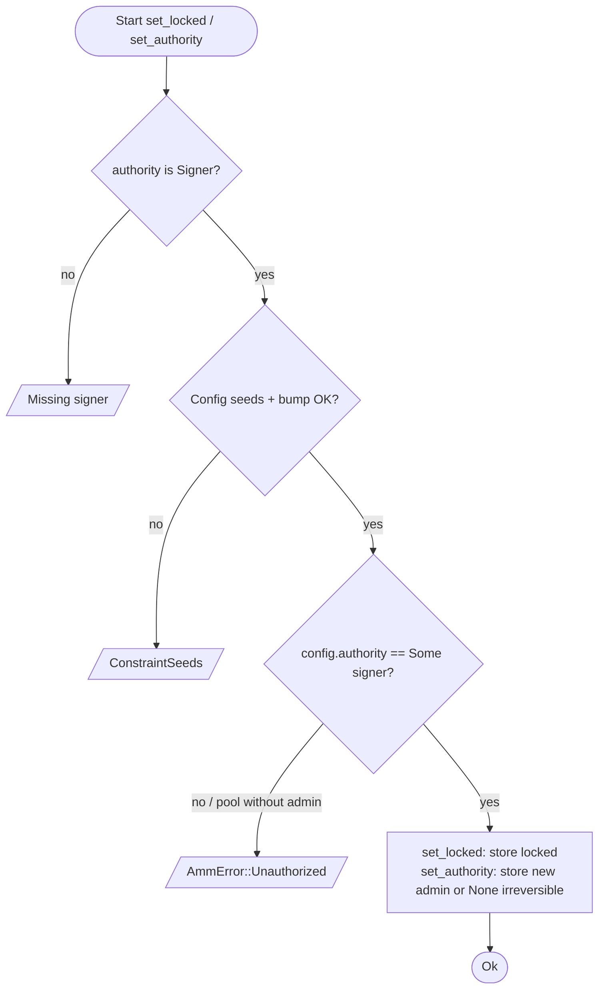
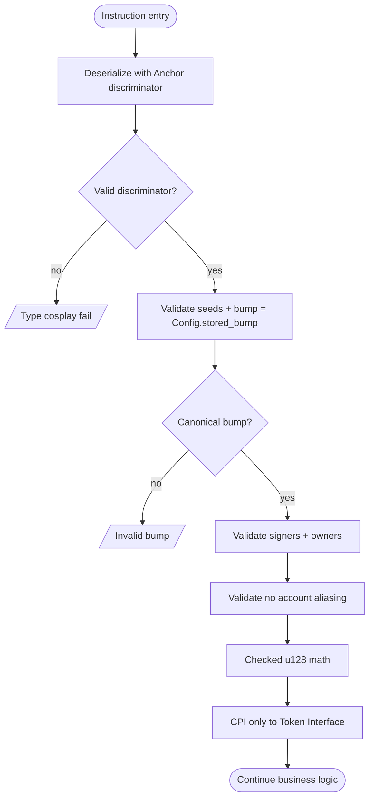

# Flowcharts — solana-amm-anchor

> 🇪🇸 [Versión en español](flujograma-ES.md) · [Index](../README.md)

Per-instruction decision flowcharts (error handling, Sealevel validations, and math).

---

## 1. initialize

---

## 2. deposit

---

## 3. withdraw

> `withdraw` does not check `config.locked`: a pause can never trap LP funds.

---

## 4. swap

---

## 5. set_locked / set_authority (admin)

---

## 6. Cross-cutting security path (every state-mutating instruction)

---

## Common errors legend

| Code / condition | Mitigation |
|------------------|------------|
| Missing signer | `Signer<'info>` |
| Type cosplay | `#[account]` + discriminator |
| IdenticalVaults | `require_keys_neq!` |
| Arbitrary CPI | `Interface<'info, TokenInterface>` |
| SlippageExceeded | `min_out` / `min_lp` / `min_x|y` |
| First deposit inflation | `MINIMUM_LIQUIDITY` lock |
| Unbalanced deposit | Only the pool ratio is pulled (`deposit_quote`) |
| PoolLocked | Admin pause on deposit/swap; withdraw always open |
| Unauthorized | `config.authority == Some(signer)` on admin instructions |
| MintHasFreezeAuthority / UnsupportedMintExtension | Mint policy in `initialize` |
| Overflow | `checked_*` + `u128` |
